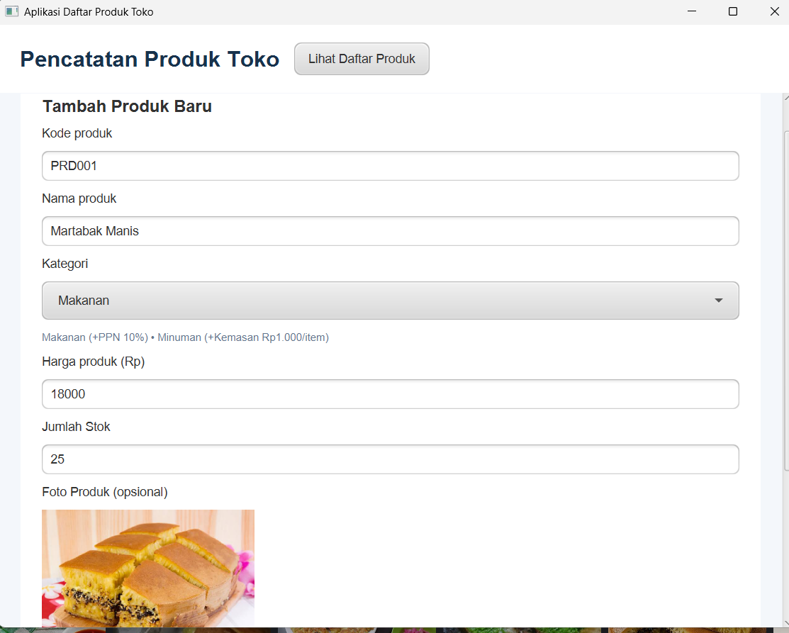
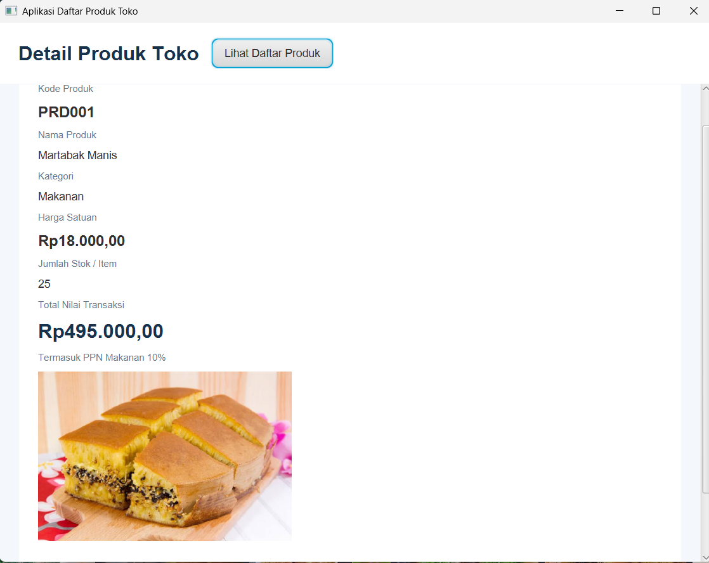
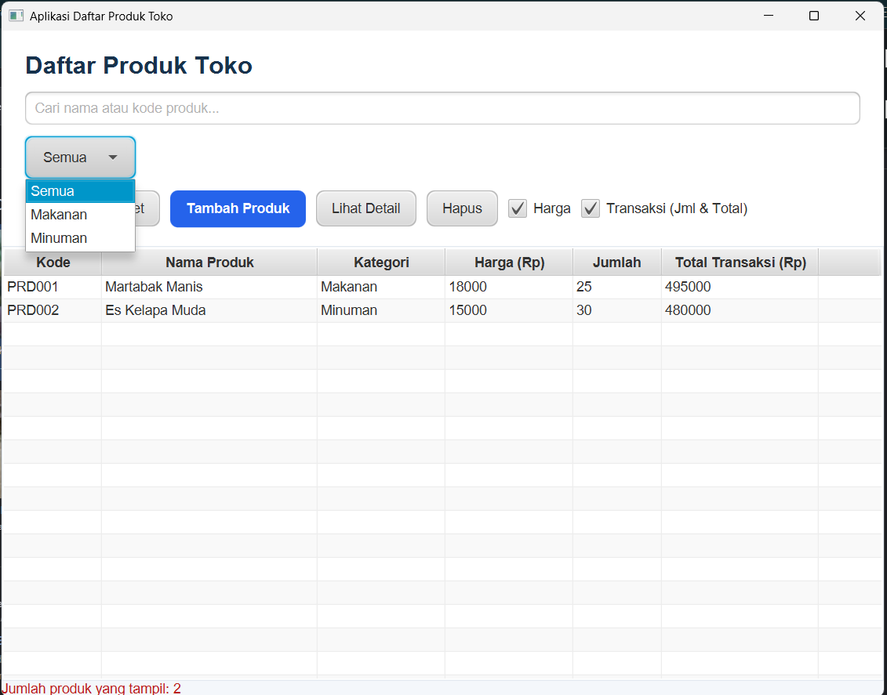

# Aplikasi Daftar Produk Toko (ProdukApp)

Aplikasi desktop untuk mencatat dan mengelola daftar produk toko. Dibangun menggunakan **JavaFX 21** dan **Maven**, aplikasi ini menerapkan konsep Pemrograman Berorientasi Objek (OOP), yaitu *Encapsulation*, *Inheritance*, dan *Polymorphism*, dengan pemisahan yang jelas antara Model, Data, Controller, dan View (FXML/CSS).

## Fitur Utama

- **Form Tambah Produk**
  Input kode produk (otomatis atau manual), nama produk, kategori (`Makanan` / `Minuman`), harga satuan, jumlah stok, serta lampiran foto produk lokal (PNG/JPEG, maks. 5 MB).
- **Validasi Input**
  Menolak nama produk yang kosong serta harga atau jumlah yang tidak valid (≤ 0).
- **Perhitungan Otomatis (Inheritance & Polymorphism)**
  - `ProdukMakanan`: menghitung total nilai transaksi ditambah PPN 10%.
  - `ProdukMinuman`: menghitung total nilai transaksi ditambah biaya kemasan Rp1.000 per item.
- **Tabel & Pencarian Produk**
  Menampilkan seluruh produk dalam `TableView` dengan pencarian kata kunci (nama atau kode) melalui tombol **Cari**, filter kategori, serta opsi untuk menyembunyikan atau menampilkan kolom.
- **Halaman Detail Produk**
  Menampilkan rincian lengkap objek `Produk` yang dipilih beserta pratinjau gambar lokal.

## Tampilan Aplikasi

### 1. Halaman Form Tambah Produk


### 2. Halaman Detail Produk


### 3. Halaman Daftar & Pencarian Produk


## Teknologi

| Komponen        | Versi / Keterangan       |
|-----------------|--------------------------|
| Java (JDK)      | 21 atau lebih baru       |
| JavaFX          | 21                       |
| Apache Maven    | 3.8 atau lebih baru      |

## Struktur Proyek

```text
ProdukApp/
├── pom.xml
├── nbactions.xml
├── screenshots/
│   ├── view_form.png
│   ├── view_detail.png
│   └── view_daftar.png
└── src/main/
    ├── java/kelas/
    │   ├── MainApp.java
    │   ├── Navigator.java
    │   ├── model/       (Produk, ProdukMakanan, ProdukMinuman)
    │   ├── data/        (DataProduk)
    │   └── controller/  (FormController, DetailController, DaftarController)
    └── resources/kelas/
        ├── form.fxml
        ├── detail.fxml
        ├── daftar.fxml
        └── styles/app.css
```

## Instalasi

### Prasyarat

Pastikan perangkat sudah terpasang:

1. **JDK 21** atau lebih baru. Cek dengan perintah:
   ```bash
   java -version
   ```
2. **Apache Maven 3.8+**. Cek dengan perintah:
   ```bash
   mvn -version
   ```
3. **Git** (opsional, untuk meng-clone repositori).

### Langkah Instalasi

1. Clone repositori atau unduh sumber kode:
   ```bash
   git clone https://github.com/egiyudasebayang-collab/ProdukApp.git
   cd ProdukApp
   ```
2. Unduh dan pasang semua dependensi Maven:
   ```bash
   mvn clean install
   ```

## Cara Menjalankan

### Menggunakan Maven

Jalankan aplikasi langsung dari terminal dengan plugin JavaFX:

```bash
mvn javafx:run
```

### Menggunakan IDE

1. Buka folder `ProdukApp` di NetBeans, IntelliJ IDEA, atau Eclipse.
2. Tunggu hingga Maven selesai memuat dependensi.
3. Jalankan kelas `kelas.MainApp`.

### Membuat File JAR (Opsional)

```bash
mvn clean package
```

> Catatan: JAR yang dihasilkan memerlukan modul JavaFX di classpath. Untuk distribusi, gunakan `mvn javafx:run` atau plugin `jlink`/`jpackage`.

## Cara Penggunaan Singkat

1. Buka menu **Form** untuk menambahkan produk baru, lalu isi kode, nama, kategori, harga, jumlah, dan foto (opsional).
2. Simpan produk. Data akan langsung muncul di halaman daftar.
3. Buka halaman **Daftar** untuk mencari produk berdasarkan nama atau kode, atau memfilter berdasarkan kategori.
4. Pilih salah satu baris produk untuk melihat **Detail** lengkapnya.

